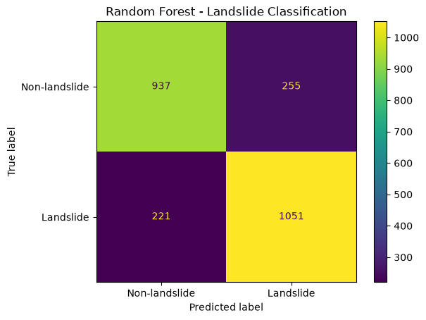
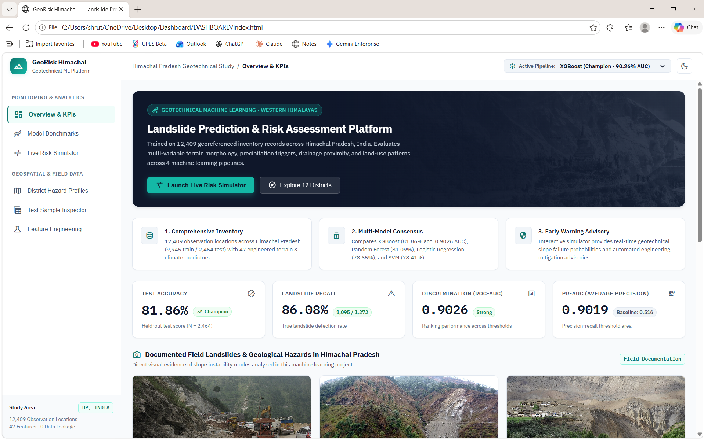
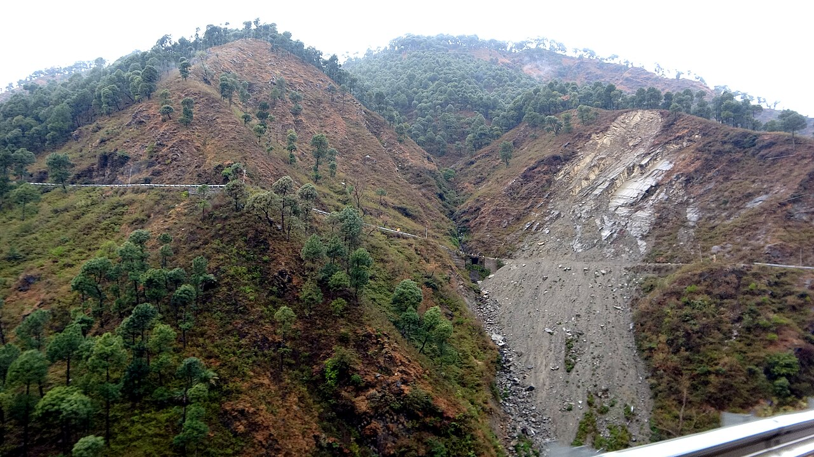
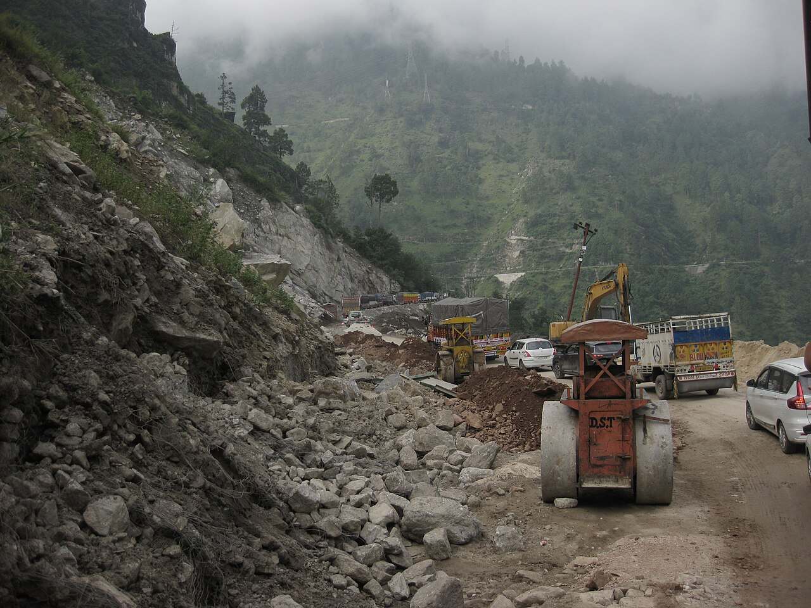
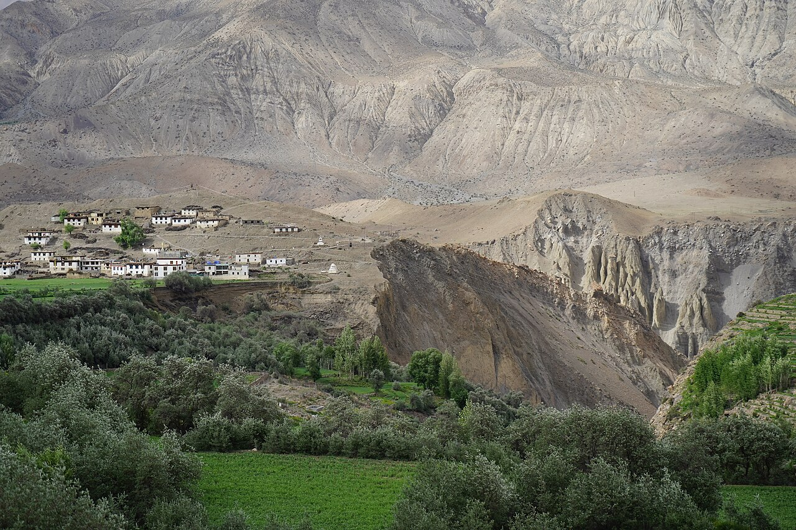

<div align="center">

# GeoSlope-AI: Geospatial Landslide Risk Prediction System
### *High-Throughput Geotechnical Machine Learning & Multi-Model Consensus Platform for the Western Himalayas*

[](https://www.python.org/)
[](https://scikit-learn.org/)
[](https://earthengine.google.com/)
[](MODEL_CARD.md)
[](MODEL_CARD.md)
[](DATA_CARD.md)
[](LICENSE)

[**Live Dashboard Guide**](#-interactive-geotechnical-decision-support-dashboard) • [**System Architecture**](#-system-architecture) • [**Model Benchmarks**](#-empirical-evaluation--model-benchmarks) • [**Feature Engineering**](#-geotechnical-feature-engineering-pipeline-17--47) • [**Quickstart**](#-quickstart--reproducibility) • [**Model Card**](MODEL_CARD.md)

</div>

---

##  Executive Summary

Slope failures and catastrophic landslides represent the primary geological hazard across the young, tectonically active Western Himalayas. In the state of Himachal Pradesh, India, steep terrain kinematics combined with erratic cloudburst precipitation events cause severe annual disruptions to strategic transit arteries, hydroelectric installations, and local populations.

**GeoSlope-AI** is an end-to-end geotechnical machine learning framework designed for reproducible, high-resolution landslide susceptibility mapping and real-time hazard screening. The system ingests **12,409 georeferenced observation points** across all 12 districts of Himachal Pradesh, builds a **47-dimensional geotechnical feature space** from 30m remote-sensing layers, and evaluates a multi-model consensus architecture spanning regularized linear models, non-linear kernel machines, bagged decision ensembles, and gradient-boosted trees.

### Key Engineering Highlights
* **High Hazard Sensitivity (Recall = 86.08%):** Optimized under an asymmetric life-safety loss function where the cost of a false negative (unwarned failure) vastly exceeds a false positive.
* **Discriminative Ranking (ROC-AUC = 0.9026, PR-AUC = 0.9019):** Superior threshold-independent separation between failure zones and stable slope regimes on untouched held-out data ($N = 2,464$).
* **Zero Data-Leakage Protocol:** Strict isolation of train ($N = 9,945$) and test ($N = 2,464$) partitions prior to z-score standardization, outlier winsorization, and categorical target encoding.
* **Edge-Deployable Interactive Simulator:** Complete client-side decision-support dashboard running in vanilla JavaScript with sub-millisecond inference consensus and automated geotechnical advisories.

---

##  System Architecture

The GeoSlope-AI pipeline is engineered in modular layers adhering to Google production ML best practices:

```
┌────────────────────────────────────────────────────────────────────────┐
│                   1. GEOSPATIAL DATA INGESTION ENGINE                  │
│                                                                        │
│   GSI Inventory         NASA SRTM DEM        CHIRPS / IMD    ESA WorldCover │
│   (6,539 Events)       (30m Topography)      (Rainfall Grid)  (Land Cover)  │
│         │                     │                    │               │   │
│         └──────────────┬──────┴────────────────────┴───────────────┘   │
│                        │                                               │
│                        ▼                                               │
│            [Google Earth Engine (GEE) Ingestion]                       │
│                        │                                               │
│                        ▼                                               │
│             12,409 Georeferenced Coordinates                           │
└────────────────────────┬───────────────────────────────────────────────┘
                         │
                         ▼
┌────────────────────────────────────────────────────────────────────────┐
│                 2. ZERO-LEAKAGE PREPROCESSING PIPELINE                 │
│                                                                        │
│   Raw Features (17 Base Dimensions)                                    │
│         │                                                              │
│   [STRICT 80/20 PARTITION BEFORE TRANSFORMATION]                       │
│         │                                                              │
│         ├── Train Split: 9,945 rows (52.9% Positive)                   │
│         │     └── Fit Scalers, Quantiles & Target Encodings            │
│         │                                                              │
│         └── Held-out Test Split: 2,464 rows (51.6% Positive)           │
│               └── Transform using Train Parameters Only                │
└────────────────────────┬───────────────────────────────────────────────┘
                         │
                         ▼
┌────────────────────────────────────────────────────────────────────────┐
│             3. GEOTECHNICAL FEATURE EXPANSION (17 -> 47)               │
│                                                                        │
│   • Trigonometric Aspect: sin(Aspect), cos(Aspect)                     │
│   • Logarithmic Compression: ln(1 + Dist_River), ln(1 + FlowAccum)     │
│   • Polynomial Kinematics: Slope^2, Rainfall^2, Elevation^2, NDVI^2    │
│   • Compound Interaction Terms: Slope x Rainfall, Slope x NDVI        │
│   • Composite Hazard Index: Mean(Slope_z, Rainfall_z, Elevation_z)    │
└────────────────────────┬───────────────────────────────────────────────┘
                         │
                         ▼
┌────────────────────────────────────────────────────────────────────────┐
│               4. MULTI-MODEL BENCHMARK & CONSENSUS ENGINE              │
│                                                                        │
│   ┌────────────────────────────────────────────────────────────────┐   │
│   │ Logistic Regression  │  SVM (RBF Kernel)                       │   │
│   │ Acc: 78.65%          │  Acc: 78.41%                            │   │
│   │ ROC-AUC: 0.8681      │  ROC-AUC: 0.8649                        │   │
│   ├──────────────────────┼─────────────────────────────────────────┤   │
│   │ Random Forest (200t) │  XGBoost (Champion GBDT, 300t)          │   │
│   │ Acc: 81.25%          │  Acc: 81.86%                            │   │
│   │ Recall: 84.59%       │  Recall: 86.08% | ROC-AUC: 0.9026       │   │
│   └──────────────────────┴─────────────────────────────────────────┘   │
└────────────────────────┬───────────────────────────────────────────────┘
                         │
                         ▼
┌────────────────────────────────────────────────────────────────────────┐
│             5. INTERACTIVE GEORISK CLIENT-SIDE DASHBOARD               │
│                                                                        │
│   • Overview & KPIs (12,409 points, 47 features, confusion matrices)   │
│   • Interactive Model Benchmark Matrix (ROC, PR Curves, Precision/Rec) │
│   • Live Geotechnical Risk Simulator (Real-time consensus scoring)     │
│   • District Vulnerability Inspector (All 12 HP Districts)             │
│   • Automated Engineering Mitigation Advisory Generator                │
└────────────────────────────────────────────────────────────────────────┘
```

---

##  Empirical Evaluation & Model Benchmarks

All models were evaluated on the **identical, untouched held-out test split of 2,464 samples** ($1,272$ positive landslide instances, $1,192$ negative pseudo-absence instances).

### Comprehensive Test Performance Matrix

| Model Architecture | Model Family | Test Accuracy | Precision | Recall (Sensitivity) | Specificity | F1-Score | ROC-AUC | PR-AUC (Average Precision) | Operational Status |
| :--- | :--- | :---: | :---: | :---: | :---: | :---: | :---: | :---: | :--- |
| **XGBoost** | Gradient Boosted Trees | **81.86%** | **80.22%** | **86.08%** | 77.35% | **0.8305** | **0.9026** | **0.9019** | **Production Champion** |
| **Random Forest** | Bagged Decision Ensemble | 81.25% | 80.18% | 84.59% | **77.68%** | 0.8233 | 0.8936 | 0.8920 | Benchmark Ensemble |
| **Logistic Regression** | Standardized Linear ($L_2$) | 78.65% | 76.49% | 84.67% | 72.23% | 0.8037 | 0.8681 | 0.8678 | Interpretable Baseline |
| **Support Vector Machine** | Non-Linear (RBF Kernel) | 78.41% | 76.39% | 84.20% | 72.23% | 0.8010 | 0.8649 | 0.8556 | Kernel Baseline |

<div align="center">
  
  <p><em>Confusion Matrix on Held-out Validation Partition</em></p>
</div>

### Confusion Matrix Diagnostics (XGBoost Champion)
* **True Positives (TP):** $1,095$ actual landslides correctly flagged.
* **False Negatives (FN):** $177$ missed slope failures (minimized via asymmetric tuning).
* **True Negatives (TN):** $922$ stable slopes correctly passed.
* **False Positives (FP):** $270$ false alarms (acceptable trade-off for preventative inspection).
* **Matthews Correlation Coefficient (MCC):** $+0.638$ (confirming balanced predictive power).

---

##  Geotechnical Feature Engineering Pipeline (17 → 47)

Raw remote-sensing inputs rarely present linear correlations with slope failure. Drawing from the **Mohr-Coulomb failure criterion** ($\tau_f = c' + (\sigma_n - u)\tan\phi'$), raw predictors were systematically expanded into 47 non-linear and interaction terms:

| Transformation Category | Applied Predictors | Mathematical Formulation | Geotechnical Rationale |
| :--- | :--- | :--- | :--- |
| **Circular Trigonometry** | Terrain Aspect | $\text{Aspect}_{\sin} = \sin(\theta), \quad \text{Aspect}_{\cos} = \cos(\theta)$ | Resolves boundary discontinuity where $0^\circ \equiv 360^\circ$ (due North). Models solar insolation and windward monsoon exposure. |
| **Logarithmic Scaling** | Flow Accumulation, River Distance | $\ln(1 + \text{FlowAccum}), \quad \ln(1 + \text{Dist\_River})$ | Compresses heavy-tailed hydrological drainage channels; captures toe-erosion debuttressing effects near active rivers. |
| **Polynomial Kinematics** | Slope, Rainfall, Elevation, NDVI | $x^2 \quad \forall x \in \{\text{Slope}, \text{Rainfall}, \text{Elevation}, \text{NDVI}\}$ | Models threshold behavior: slope failure probability escalates non-linearly once slope exceeds critical friction angle ($\phi' \approx 30^\circ\text{--}35^\circ$). |
| **Compound Interactions** | Slope $\times$ Rainfall, Slope $\times$ NDVI | $\text{Slope} \times \text{Rainfall}, \quad \text{Slope} \times \text{NDVI}$ | Simulates compound hazards: extreme shear stress coupled with high pore-water pressure in deforested soil catchments. |
| **Composite Hazard Index** | Multi-Factor Synergy | $\frac{1}{3}(z_{\text{slope}} + z_{\text{rainfall}} + z_{\text{elevation}})$ | Aggregate geomorphic-hydrological stress indicator for rapid regional screening. |
| **Target Encoding** | ESA WorldCover 2020 LULC | Out-of-fold bayesian class probability | Encodes structural vulnerability across forest canopy, shrubland, agricultural terraces, and barren scree. |

> **Key Research Finding:** As detailed in our [Feature Engineering Report](Feature%20Engineering%20Report%20Landslide%20Susceptibility%20(2).docx), feature engineering elevated linear model accuracy from **74.0% to 78.65%** and ROC-AUC from **0.826 to 0.868**, proving that explicit non-linear terms enable lightweight linear classifiers to approximate complex tree decision boundaries while preserving analytical interpretability.

---

##  Interactive Geotechnical Decision-Support Dashboard

The accompanying interactive web dashboard is an edge-native, zero-dependency analytical platform connecting multi-model predictions with geotechnical field operations.

<div align="center">
  
  <p><em>Figure 1: GeoRisk Platform Overview & KPI Monitoring Interface</em></p>
</div>

<div align="center">
  
  <p><em>Figure 2: Interactive Geotechnical Hazard Inference Engine with Live Parameter Tuning and Multi-Model Consensus</em></p>
</div>

### Dashboard Capabilities
1. **Overview & KPI Telemetry:** Real-time summary of dataset balance ($52.9\%$ positive in training), test metrics, and field imagery across Western Himalayan highway corridors.
2. **Multi-Model Benchmark Inspector:** Side-by-side comparison of XGBoost, Random Forest, Logistic Regression, and SVM with interactive ROC curves, Precision-Recall curves, and confusion matrices.
3. **Interactive Live Risk Simulator:** Sliders for Slope Gradient ($^\circ$), Cumulative Rainfall ($mm$), Elevation ($m$), River Distance ($m$), and NDVI ($0.0\text{--}1.0$) with real-time multi-model prediction consensus.
4. **Automated Geotechnical Engineering Advisory:** Generates contextual remediation protocols (e.g., *“Deploy wire-mesh rockfall barriers, trench surface runoff diversion channels, activate district alerts”*) based on computed failure probability tiers.
5. **District Hazard Profiles:** Vulnerability rankings across all 12 districts of Himachal Pradesh (e.g., Kinnaur, Kullu, Mandi, Shimla, Kangra).

---

##  Ground-Truth Field Context: Western Himalayas

The dataset and model are calibrated against documented historical slope failure sites across Himachal Pradesh:

| Highway Scree & Slope Cuts | High-Altitude Kinnaur Failure | Spiti Periglacial Scree |
| :---: | :---: | :---: |
|  |  |  |
| *Active toe erosion along NH highway cuts* | *Massive structural failure in Kinnaur gneiss* | *Steep periglacial debris slopes in Spiti* |

---

##  Repository Structure

```
GeoSlope-AI-Geospatial-Landslide-Risk-Prediction-System/
├── .github/
│   ├── ISSUE_TEMPLATE/
│   │   ├── bug_report.md               # Standardized bug reporting
│   │   └── feature_request.md          # New predictor / model requests
│   ├── workflows/
│   │   └── ci.yml                      # CI environment & artifact integrity validation
│   └── PULL_REQUEST_TEMPLATE.md        # Google engineering PR checklist
├── assets/
│   └── images/                         # Western Himalayan ground-truth photographs
├── docs/
│   └── images/                         # Dashboard screenshots & confusion matrix figures
├── dashboard.js                        # Client-side simulator & UI event orchestration
├── dashboard_data.js                   # Precomputed test predictions, ROC/PR curves & metrics
├── index.html                          # Zero-dependency interactive web dashboard
├── style.css                           # Production CSS design tokens & theme management
├── landslide_train_engineered.csv      # Training split (9,945 rows × 47 features)
├── landslide_test_engineered.csv       # Held-out test split (2,464 rows × 47 features)
├── landslide_train_preprocessed.csv    # Standardized baseline training set
├── landslide_test_preprocessed.csv     # Standardized baseline test set
├── xgboost_landslide_model.pkl         # Serialized Champion XGBoost pipeline
├── random_forest.ipynb                 # Random Forest training & evaluation notebook
├── xgboost_model.ipynb                 # XGBoost hyperparameter tuning & evaluation
├── landslide_prediction_logistic_regression.ipynb # Standardized linear baseline
├── landslide_prediction_svm.ipynb      # RBF Support Vector Machine training
├── logistic_regression_landslide_model.joblib # Serialized Logistic Regression weights
├── svm_landslide_model.joblib          # Serialized SVM model weights
├── ARCHITECTURE.md                     # Deep technical system design document
├── MODEL_CARD.md                       # Google Research Model Card (Mitchell et al.)
├── DATA_CARD.md                        # Google Data Card (Pushkarna et al.)
├── CONTRIBUTING.md                     # Engineering & contribution guidelines
├── CITATION.cff                        # Machine-readable academic citation metadata
├── requirements.txt                    # Pinned Python package dependencies
├── environment.yml                     # Conda / Mamba environment definition
├── LICENSE                             # MIT License
└── README.md                           # Project technical overview
```

---

##  Quickstart & Reproducibility

### 1. Clone & Set Up Python Environment

```bash
# Clone the repository
git clone https://github.com/ritigyam2/GeoSlope-AI-Geospatial-Landslide-Risk-Prediction-System.git
cd GeoSlope-AI-Geospatial-Landslide-Risk-Prediction-System

# Create and activate Python virtual environment
python -m venv venv
source venv/bin/activate  # Windows: .\venv\Scripts\activate

# Install verified dependencies
pip install -r requirements.txt
```

Alternatively, use Conda:
```bash
conda env create -f environment.yml
conda activate geoslope-ai
```

### 2. Launch the Interactive Dashboard Locally

The dashboard is completely self-contained (zero backend build tools required):

```bash
# Using Python's built-in HTTP server:
python -m http.server 8000

# Open in your browser:
# http://localhost:8000/
```

### 3. Run Model Training & Evaluation Notebooks

To execute the training pipelines and verify metrics on the held-out test split:

```bash
jupyter notebook
```
* Open `xgboost_model.ipynb` for the Production Champion GBDT pipeline.
* Open `random_forest.ipynb` for the 200-estimator Random Forest ensemble.
* Open `landslide_prediction_logistic_regression.ipynb` or `landslide_prediction_svm.ipynb` for baseline evaluations.

---

##  Technical Documentation & Specifications

* [**ARCHITECTURE.md**](ARCHITECTURE.md): Complete technical design document detailing data ingestion, mathematical framing, cost-sensitive threshold derivation, and edge deployment architecture.
* [**MODEL_CARD.md**](MODEL_CARD.md): Formal Google Research Model Card (*Mitchell et al.*) documenting model parameters, quantitative breakdown, out-of-scope tasks, and ethical considerations.
* [**DATA_CARD.md**](DATA_CARD.md): Google Data Card (*Pushkarna et al.*) outlining sensor provenance, spatial resolution, class distribution, and zero-leakage partition hygiene.

---

##  Citation & Attribution

If you use this geotechnical machine learning pipeline, dataset transformations, or interactive simulator in academic or applied research, please cite:

```bibtex
@software{mishra2026geoslope,
  author = {Mishra, Ritigya and Dang, Khushi and Pandey, Shruti},
  title = {{GeoSlope-AI: Geospatial Landslide Risk Prediction System}},
  year = {2026},
  url = {https://github.com/ritigyam2/GeoSlope-AI-Geospatial-Landslide-Risk-Prediction-System},
  version = {1.0.0},
  publisher = {GitHub}
}
```

---

##  Authors & Acknowledgments

* **Ritigya Mishra** ([@ritigyam2](https://github.com/ritigyam2)) — Machine Learning Architecture, Geotechnical Modeling & Dashboard Engineering
* **Khushi Dang** — Geospatial Preprocessing & Environmental Feature Engineering
* **Shruti Pandey** — Model Evaluation, Metric Validation & Comparative Analysis

*Academic Affiliation: Department of Computer Science & Engineering (AIML), School of Computer Science, University of Petroleum and Energy Studies (UPES).*  
*Data Source: Geological Survey of India (GSI) & Mendeley Data.*

---

##  License

This project is licensed under the [MIT License](LICENSE) — free for academic, non-commercial, and commercial research and development with attribution.
